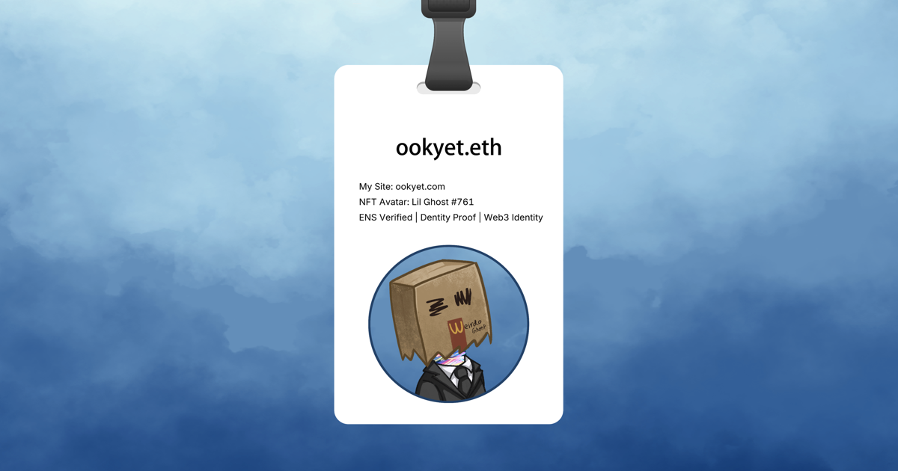

# ookyet

[](https://x.com/ookyet)


<p align="center">
  
</p>

**I'm Qifeng Huang, known online as ookyet** — a digital creator anchoring a verifiable digital identity across ENS (`ookyet.eth`), an NFT avatar, Dentity verification, and consistent social profiles.

---

## 💡 Why Verifiable Web3 Identity?

Traditional platforms own your identity. They can ban you, impersonate you, fragment you across silos.

**A verifiable identity flips the model:**

| Traditional | ookyet |
|------------|--------|
| Platform-controlled | Self-sovereign ENS anchor (`ookyet.eth`) |
| Easy to fake | Cryptographic proof — Lil Ghost #761, owned on-chain |
| Fragmented | One handle, one avatar, every public platform — audited on the [proof hub](https://ookyet.com/proof/) |
| Search invisible | Google Knowledge Graph entity ✓ |

> A verifiable identity isn't one credential — it's the convergence of on-chain ownership, human verification, and public evidence.

**This is a template, not a flex.** Architecture: [web3-identity-seo](https://github.com/ookyet/web3-identity-seo)

## Verify
- ✅ **Identity Proof:** https://ookyet.com/proof/
- ✅ **ENS name:** `ookyet.eth`
- ✅ **Dentity credential:** https://app.dentity.com/ookyet.eth

## What is ookyet?

**ookyet** is the person — the primary identity. `ookyet.eth` is its ENS anchor.

Rather than treating identity as a username, it is built as a long-term public system supported by verifiable evidence: on-chain assets (ENS, NFT avatar) and off-chain proofs (Dentity KYC, social profiles) converge into one publicly auditable persona — person-first, with zero trust assumptions.

## Identity pillars
- **ENS**: `ookyet.eth` — the verifiable anchor: human-readable name ↔ on-chain address
- **NFT avatar**: _Lil Ghost #761_ — owned on-chain; the consistent visual signature across platforms
- **Sovereign site**: https://ookyet.com — the identity's single source of truth (entity graph, proof hub, evidence gallery)
- **Dentity**: binding personhood ↔ ENS ↔ social accounts
- **Schema.org**: server-rendered `@graph` entity modeling — machine-readable identity for search engines

## Verification guide
- [ ] **ENS control:** resolve `ookyet.eth`, note controller/owner
- [ ] **Avatar binding:** wallet holds **Lil Ghost #761** (contract + tokenId)
- [ ] **Off-chain consistency:** proofs on https://ookyet.com/proof/ (cross-check Dentity)
- [ ] **Audit trail:** snapshots & live links in https://ookyet.com/gallery/

<details>
<summary><b>Step-by-step verification guide</b></summary>

1. **Check ENS ownership**
   Resolve `ookyet.eth` via your preferred ENS/Etherscan/Wallet tool and note the controller/owner address.

2. **Check avatar provenance**
   Confirm the wallet above also **owns _Lil Ghost #761_** (contract + token id). This binds the avatar to the ENS name.

3. **Check off-chain consistency**
   Visit **https://ookyet.com/proof/** to see signed, linkable proofs to X/Instagram and other surfaces. Optionally cross-check **https://app.dentity.com/ookyet.eth** for credential bindings.

4. **View the audit trail**
   Browse **https://ookyet.com/gallery/** for snapshots and live links showing the identity's visual and link-level consistency.

> When ENS control, NFT ownership, and social handles converge under the same controller, the identity is publicly verifiable.

</details>

---

## Open Source

### [web3-identity-seo](https://github.com/ookyet/web3-identity-seo)
Making ENS domains discoverable by search engines through Schema.org entity modeling and third-party verification networks. Documented outcome: a machine-generated **Google Knowledge Graph Person entity** for this identity (Jul 2026).

**Tech:** Shell · Hugo · Schema.org · Web3

---

## Snippets

<details>
<summary><b>OG image — Markdown</b></summary>

```markdown

```

</details>

<details>
<summary><b>OG image — HTML (centered)</b></summary>

```html
<p align="center">
  
</p>
```

</details>

<details>
<summary><b>Badges (Markdown)</b></summary>

```markdown
[](https://x.com/ookyet)


```

</details>

<details>
<summary><b>Schema.org — JSON-LD (Person, person-first)</b></summary>

Person-first rule: `name` is the person/handle — never the ENS domain. The ENS name
belongs in `alternateName` and `identifier` as a verifiable anchor. See
[web3-identity-seo](https://github.com/ookyet/web3-identity-seo) for the full model.

```json
{
  "@context": "https://schema.org",
  "@type": "Person",
  "name": "ookyet",
  "alternateName": ["ookyet.eth", "@ookyet"],
  "url": "https://ookyet.com",
  "image": "https://raw.githubusercontent.com/ookyet/ookyet/main/og-card.png",
  "identifier": {
    "@type": "PropertyValue",
    "propertyID": "ens",
    "value": "ookyet.eth",
    "url": "https://app.ens.domains/name/ookyet.eth"
  },
  "sameAs": [
    "https://x.com/ookyet",
    "https://instagram.com/ookyet",
    "https://www.threads.com/@ookyet",
    "https://github.com/ookyet",
    "https://www.linkedin.com/in/qifenghuang-ookyet/",
    "https://orcid.org/0009-0005-1400-7291",
    "https://app.ens.domains/name/ookyet.eth",
    "https://etherscan.io/address/0xC5F1c8b15A658B1b36A0CF2c64b45101568B17fF",
    "https://opensea.io/assets/ethereum/0x9401518f4ebba857baa879d9f76e1cc8b31ed197/761",
    "https://app.dentity.com/ookyet.eth"
  ],
  "description": "Digital creator anchoring a verifiable digital identity across ENS, an NFT avatar, Dentity, and social profiles."
}
```

</details>

<details>
<summary><b>Minimal canonical trio</b></summary>

- **Identity Proof:** https://ookyet.com/proof/
- **ENS (on-chain):** https://app.ens.domains/name/ookyet.eth
- **Gallery (visual evidence):** https://ookyet.com/gallery/

</details>

## License & Credits

### Text
- **Repository content:** CC BY 4.0

### OG Card & Avatar
- **Copyright:** © Holder of NFT **Lil Ghost #761**
- **Personal & editorial use:** ✅ Permitted
- **Commercial reuse:** ⚠️ Requires permission
- **License:** [WGG Holder License](https://docs.weirdoghost.com/#terms)

## Tech notes

<details>
<summary><b>Implementation details</b></summary>

- **Social preview:** 1200×630 (set in **Settings → Social preview**)
- **OG image in README:** `og-card.png` (served via raw.githubusercontent.com)
- **This is a special profile repository:** `ookyet/ookyet` (displayed on GitHub profile)

</details>
